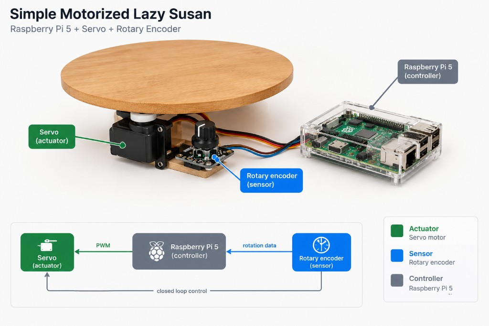
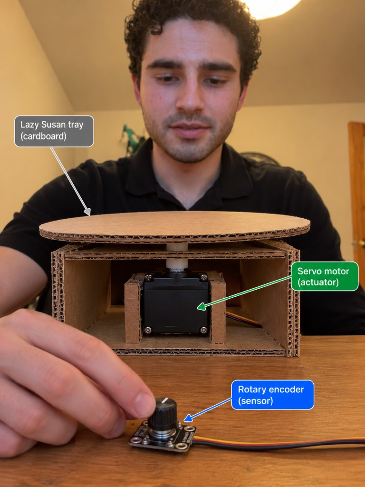
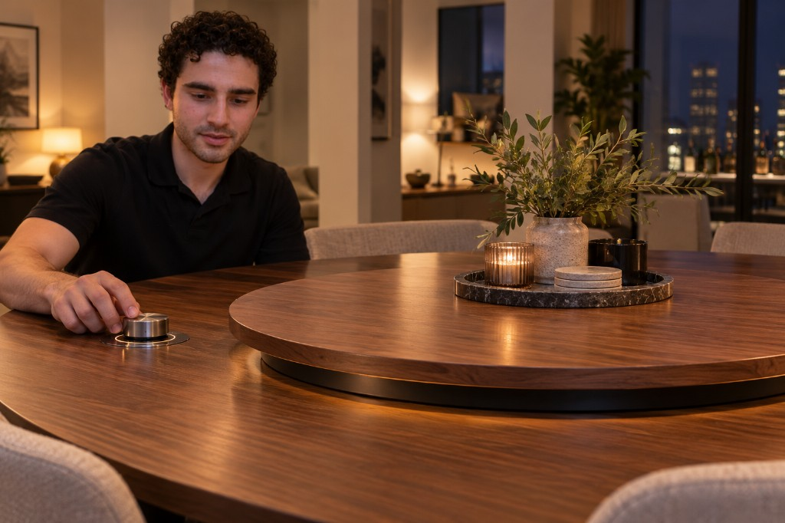

# Ph-UI!!!

## Lab Overview
Team: <canvas group name>  
Members: Elliot Waxman, EW558

---

## Part D — Physical Interaction Design: Feast Automata

**\*\*\*Draw 5 sketches that explore different physical arrangements for your sensing and actuation.\*\*\***

**\*\*\*What questions do these sketches raise? What do you need to physically prototype to answer them?\*\*\***

I made 5 sketches. Two of the sketches are different plays on the energetic suzan (a motor-powered lazy suzan). The third one is a conversation tracker that reveals which dining participant is talking the most or the least. The fourth idea was a kitchen timer that can account for multiple cooking steps. The final one is a camera enabled meat thermometer that will tell you whether your meat is likely to be cooked. These raise questions of the extent to which novelty and sillyness is welcome in dining experiences. 

**\*\*\*Pick one design to prototype and explain why.\*\*\***
I decided to pick the energetic suzan because it would be the most fun thing to build. It is silly because no one has thought to themselves (likely) "oh, I wish this lazy suzan was motor-powered". If this were an interpretive art piece, we would say that it is a commentary on the automation-first society, which rejects antiquity without consideration for whether a need truly exists. 

**\*\*\*Document your rough prototype with photos and/or video.\*\*\***
https://youtube.com/shorts/cW6RVNn26EE?is=wfLIyasyHjL_reLD

---

## Part 2

Following exploration and reflection from Part 1, complete the "looks like," "works like" and "acts like" prototypes for your design, reiterated below.

---

### Part E

#### Build & Integrate: Sensing + Actuation

For Part 2, build the Feast Automata interaction you developed in Part D by connecting sensing/input to physical actuation.

**Your prototype should:**
- Use at least one sensing or input device.
- Use servo-based physical actuation.
- Connect sensing and actuation into a meaningful interaction around eating, drinking, cooking, serving, or sharing food.
- Additional inputs, displays, LEDs, buttons, or other outputs are optional extensions.

**Document your system with:**
- Code for your sensing + actuation prototype: [`encoder_servo.py`](encoder_servo.py)
- Photos and/or video of the working prototype in action: https://youtube.com/shorts/cW6RVNn26EE?is=wfLIyasyHjL_reLD
- A simple interaction diagram or sketch showing how sensing and actuation are connected

- Written reflection: What did you learn about connecting sensing, movement, and physical form? What was fun, surprising, or challenging?

While connecting the rotary encoder, servo, and Pi, I realized that the servo-based mechanism would spin underneath the lazy Susan if I did not hold it in place. It was challenging to make the rotary encoder control the lazy Susan without lagging or stalling before spinning again. It was fun when I attached the centerpiece and it actually moved in response to the sensor.

**Questions to consider:**
- How does your chosen sensor or input shape the physical response?
- How does the physical arrangement of the sensor and actuator change the interaction?
- What thresholds, timing, or movement patterns make the interaction feel clear or playful?
- What changes when you adjust the sensor placement or servo motion?

Iterate on the sensing, movement, and physical form, and document what you discover.

One of the biggest points of iteration was changing the sensitivity of the rotary encoder. I also added structural support so that the servo base did not spin when the rotary encoder was engaged. The final movement was much smoother than in the initial video, and I taped down the wires for easier use.

---

### Part F

### Final Documentation

Document all the prototypes and iterations you have designed and worked on! Again, deliverables for this lab are writings, sketches, photos, and videos that show what your prototype:
* "Looks like": shows how the device should look, feel, sit, weigh, etc.
* "Works like": shows what the device can do
* "Acts like": shows how a person would interact with the device

#### Looks Like

The final physical prototype used a cardboard lazy Susan tray and enclosure, with structural supports holding the servo in place and a separate rotary encoder as the controller. It felt much smoother than the initial prototype, but it still lacked the size and strength needed to function as practical tableware.

The image below is a rendering of the version I built. I did not take a proper photograph before my workspace was reclaimed.

The following image shows the dream version: a larger, mechanized, and sleek lazy Susan suitable for a dining table.

#### Works Like

The rotary encoder controls the servo, which rotates the lazy Susan tray. Adjusting the encoder sensitivity and supporting the servo base made the response smoother and prevented the mechanism itself from spinning underneath the tray.

#### Acts Like

A person twists the rotary encoder to control the lazy Susan's rotation and bring dishes closer to them.

### Peer Feedback

| Date | Name | Feedback |
|---|---|---|
| 10/12/2026 | Tatiana H | I want it to be big enough and support enough weight to serve actual dishes. |
| 10/13/2026 | Conor N | I don't want the wires to flop around on the rotary. I think it would be helpful if the rotary itself stayed in place. |
| 10/14/2026 | Shane D | I want the servo speed to be limited so that dishes don't fly off of the lazy Susan at high speeds. |

---

## Deliverables \& Submission for Lab 4

The deliverables for this lab are, writings, sketches, photos, and videos that show what your prototype:
* "Looks like": shows how the device should look, feel, sit, weigh, etc.
* "Works like": shows what the device can do.
* "Acts like": shows how a person would interact with the device.

For submission, the readme.md page for this lab should be edited to include the work you have done:
* Upload any materials that explain what you did, into your lab 4 repository, and link them in your lab 4 readme.md.
* Link your Lab 4 readme.md in your main Interactive-Lab-Hub readme.md. 
* Labs are due on Mondays, make sure to submit your Lab 4 readme.md to Canvas.
